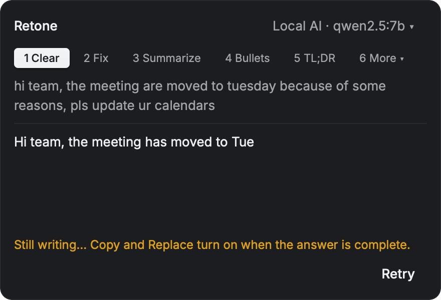
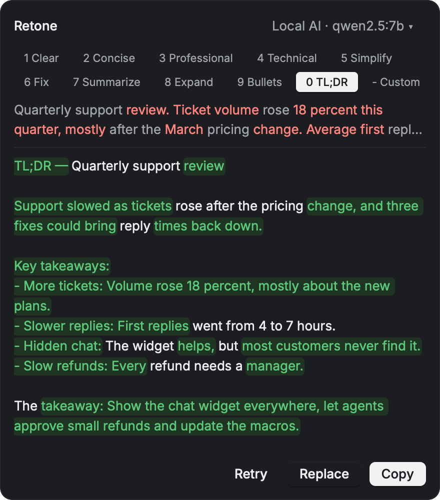
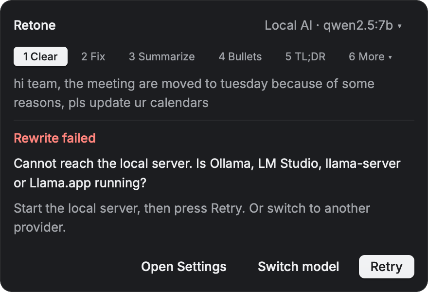
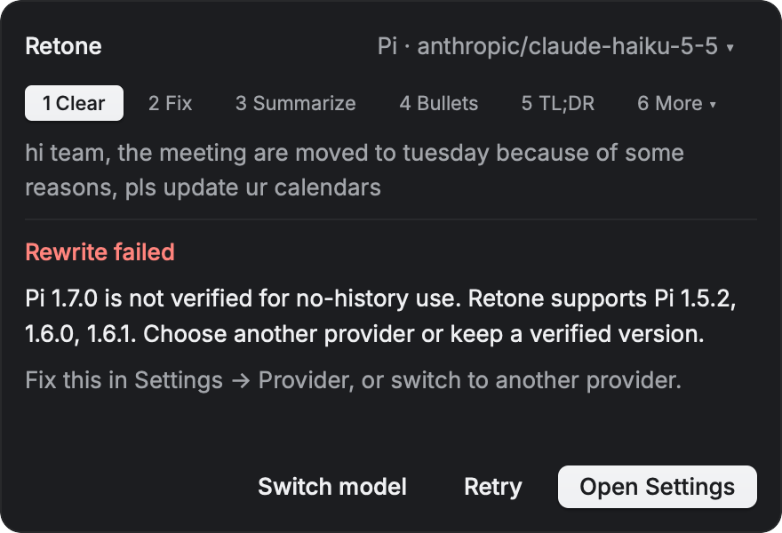
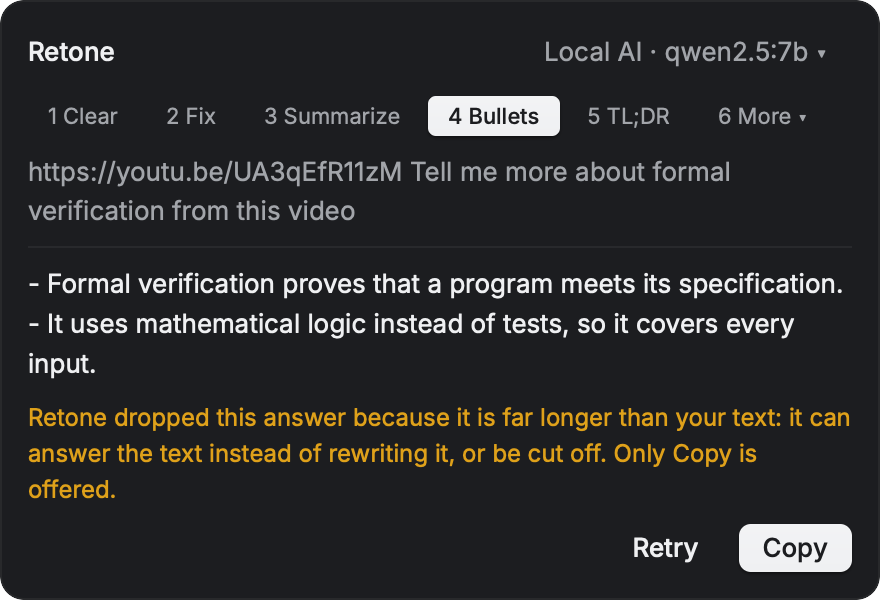
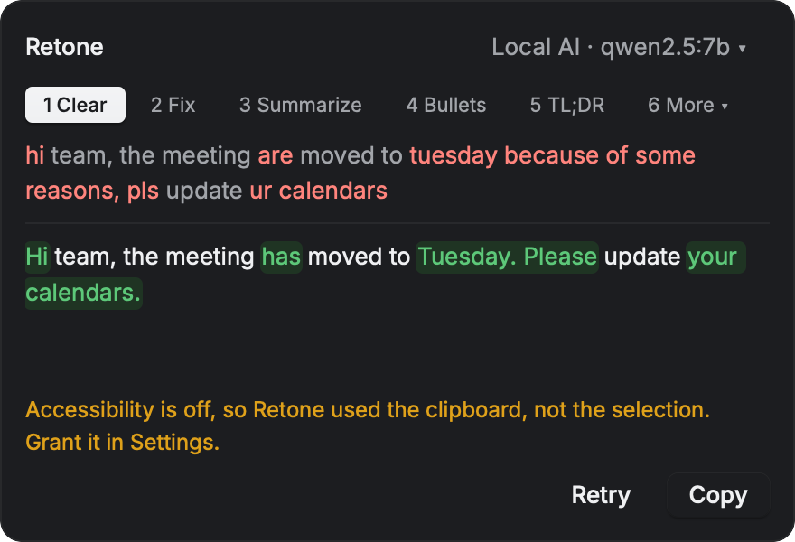
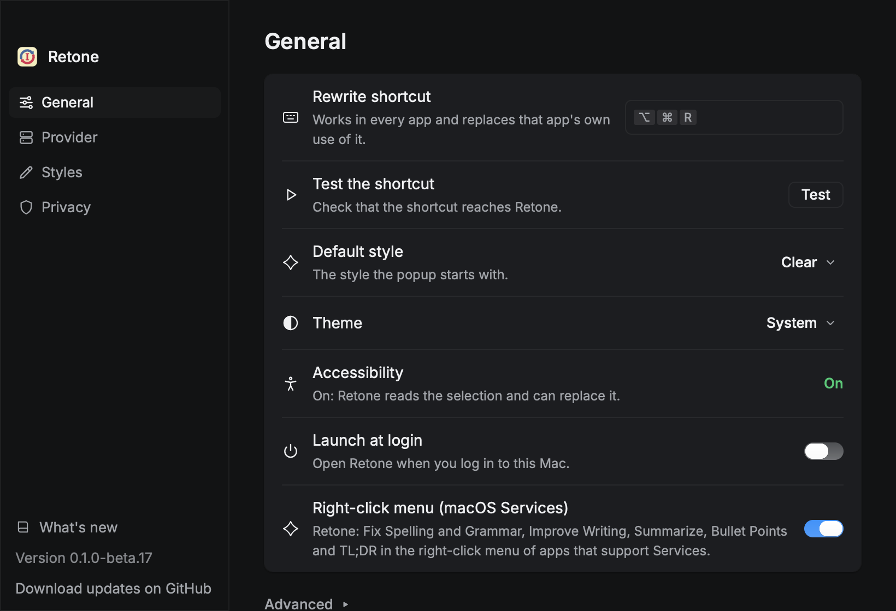
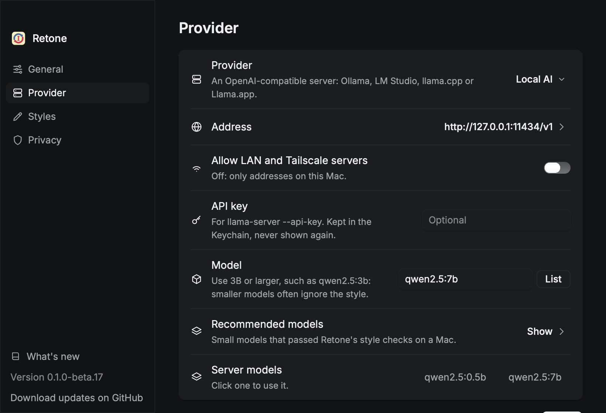
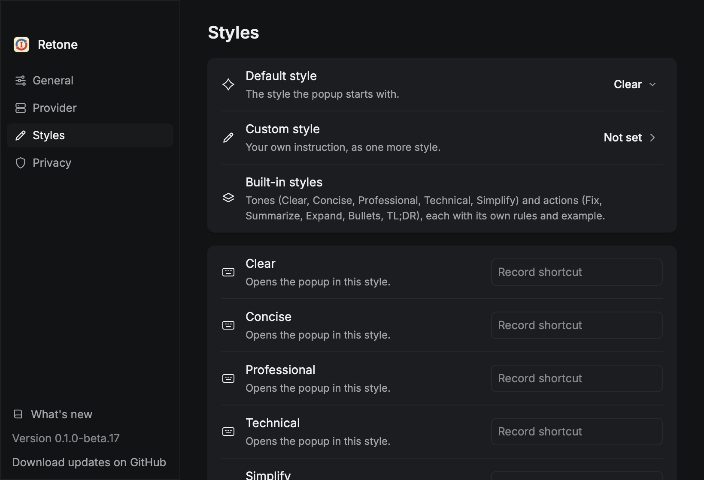

<p align="center">
  <picture>
    <source media="(prefers-color-scheme: dark)" srcset="assets/icon/logo-dark.svg">
    
  </picture>
</p>

<h1 align="center">Welcome to Retone 👋</h1>

<p align="center">
  <strong>Retone</strong> rewrites the text you select in any macOS app. Press your own hotkey, pick a style, and replace the text in place — with a local model or your own AI CLI.
</p>

<div align="center">

[](LICENSE) [](<>) [](<>) [](<>) [](https://github.com/anomalyco/rune) [](https://github.com/jellydn/retone/actions/workflows/ci.yml)

</div>

<div align="center">
  
</div>

> [!WARNING]
> **Beta.** Retone 0.1 is a first beta. It is tested in a small number of apps only. See [Known limits](#known-limits).

## Installation Requirements

- macOS 14 or later on Apple Silicon (tested on macOS 27 only)
- One AI provider: a local OpenAI-compatible server (Ollama, LM Studio, llama.cpp, [Llama.app](https://llama.app)), [Pi](https://github.com/badlogic/pi-mono), [OpenCode](https://opencode.ai), Claude Code or Codex

> [!IMPORTANT]
> **First launch security warning**
>
> Retone is not signed with an Apple Developer certificate (it is ad-hoc signed). macOS can say that the app "cannot be opened".
>
> **Quick fix**: open **System Settings → Privacy & Security** and click **Open Anyway**, or run `xattr -dr com.apple.quarantine /Applications/Retone.app`.
>
> See [TROUBLESHOOTING.md](TROUBLESHOOTING.md) for details.

## Motivation

Good writing tools often live in one app, or send your text to a cloud you did not choose. Retone works in every app where you can select text, uses the model you already run, and keeps no history: no text is saved, logged, or sent anywhere except to the provider you picked.

## Features

- ⌨️ **Your hotkey**: no default shortcut; record one in Settings, and Retone tests it with you
- 🖱️ **Right-click menu**: select text, right-click, and pick Retone: Fix Spelling and Grammar, Improve Writing, Summarize, Bullet Points or TL;DR (under Services in some apps); the popup opens with a preview
- 🎯 **Style shortcuts**: optional, one per style (Settings → Styles), to open the popup in that style
- 📍 **Popup at the caret**: the popup opens next to your text, or at the mouse pointer when the app does not report a caret
- ✍️ **Styles**: tones (Clear, Concise, Professional, Technical, Simplify), actions (Fix spelling and grammar, Summarize, Expand, Bullet points, TL;DR), or your own instruction. The popup shows one row (1 Clear, 2 Fix, 3 Summarize, 4 Bullets, 5 TL;DR); press 6 for More, a list of the other styles and your own. For Summarize, Expand and TL;DR, ↩ copies the result and ⌘↩ replaces the selection
- 👀 **Preview first**: see the rewrite before anything changes; Enter replaces, ⌘C copies, ⌘R retries with a different version, Esc cancels
- 🛡️ **Safe replace**: Retone replaces only when the same app, field and selection are still there; on failure or cancel nothing changes, and your clipboard comes back
- 🔀 **Switch provider in the popup**: click the provider label or press ⌘P to pick another provider or local model; Retone keeps the choice
- 🏠 **Local AI**: any OpenAI-compatible server on this Mac, or, after you turn it on, on your LAN or Tailscale; `http://` or `https://`
- 🧰 **CLI providers**: Pi, OpenCode, Claude Code and Codex, run with no sessions, no tools and no history
- 🔒 **No history**: the 2,000-character input limit, no text in logs, settings store no text
- 🎨 **Themes**: System, Dark, Light, or Kanagawa Lotus
- 🔄 **Updates**: Homebrew (`brew upgrade`), or Sparkle in builds signed for it

## Screenshots

**Popup**: the preview streams in, press 6 for **More** styles, click the provider label (or ⌘P) to switch model. First use of a provider asks for consent.

<div align="center">
  
  
  <br/>
  
  
  <br/>
  
</div>

**Errors say how to fix them**, with buttons for the next step.

<div align="center">
  
  
  <br/>
  
  
</div>

**Settings**: General, Provider and Styles.

<div align="center">
  
  <br/>
  
  <br/>
  
</div>

## Installation

### Using Homebrew (Recommended)

Needs a current Homebrew (with `brew trust`); run `brew update` first if `brew trust` is unknown.

```bash
# Add the tap
brew tap jellydn/retone https://github.com/jellydn/retone

# Trust only the Retone cask (Homebrew refuses casks from untrusted taps)
brew trust --cask jellydn/retone/retone

# Install Retone
brew install --cask retone
```

Update with `brew upgrade --cask retone`. When Homebrew installed Retone, the app does not update itself.

### Direct download

1. Download `Retone-<version>.dmg` (or the `.zip`) from [Releases](https://github.com/jellydn/retone/releases). Betas are marked **Pre-release**.
2. Download `SHA256SUMS` to the same folder and check your file: `shasum -a 256 -c SHA256SUMS --ignore-missing`
3. DMG: open it and drag **Retone** to **Applications**. ZIP: double-click it to extract `Retone.app`, then move `Retone.app` to **Applications**.
4. Open Retone. If macOS blocks it, see the first launch warning above.

### From source

```bash
git clone https://github.com/jellydn/retone && cd retone
scripts/bundle.sh             # target/bundle/Retone Dev.app (dev bundle ID, ad hoc)
scripts/bundle.sh --release   # target/bundle/Retone.app
```

The pinned toolchain in `rust-toolchain.toml` installs through rustup.

## Accessibility permission

Retone reads the selection and pastes the rewrite with the macOS Accessibility API.

1. Open **Settings → General** from the Retone menu-bar item, and click **Open Settings** in the **Accessibility** row.
2. Turn on **Retone** in **System Settings → Privacy & Security → Accessibility**.

Without the permission, Retone works in **clipboard mode**: copy the text first, and Retone copies the rewrite back to the clipboard. It never pastes.

> [!NOTE]
> **Re-grant after an update.** Retone is ad-hoc signed, so macOS ties the grant to one exact build. After an update the switch can show **on** but not work. Turn Retone off and on in that list, or remove it with **−** and add it again.

## Usage

1. Select text in any app.
2. Press your hotkey (or choose **Rewrite Selection** from the Retone menu-bar item).
3. Pick a style with a number key (1–5), or press **6** for **More** to see the other styles, and wait for the preview.
4. **Enter** replaces the selection, **⌘C** copies the rewrite, **⌘R** asks for a different version, **Esc** cancels. When a rewrite fails, the popup says how to fix it and offers the actions that help, such as another style or model.
5. To use another provider or model, press **⌘P** (or click the provider label at the top right), choose with **↑/↓** or a number, and press **Enter**. Retone saves the choice for the next rewrite and asks for consent first if that provider and model are new.

Retone does not run when Retone itself is in front, and refuses selections longer than 2,000 characters.

### Right-click menu (macOS Services)

You can use Retone without a hotkey:

1. Select text in an app that supports Services, for example Safari, Chrome, Mail, Notes or TextEdit.
2. Right-click the selection and choose **Retone: Fix Spelling and Grammar**, **Retone: Improve Writing**, **Retone: Summarize**, **Retone: Bullet Points** or **Retone: TL;DR**. When the menu has many items, macOS puts them under **Services ›**. You can also use the app menu: **App name › Services**.
3. The popup opens with a preview in that style. You can change to a different style with a number key, or with **6 More**.
4. For Summarize and TL;DR, **Enter** copies the result and **⌘Enter** replaces the selection. For the other styles, **Enter** replaces.

**TL;DR** is useful for long text, for example an article in Safari. When the text has about 150 words or more, you get a `TL;DR` line (with the text's own title, if it has one), the main point, key takeaways and one closing line. For a shorter text, you get only the main point in one sentence.

To turn the items off, turn off **Settings → General → Right-click menu (macOS Services)**. Retone then ignores them. macOS does not let an app hide its own Services items, so to remove them from the menu, click **Open Keyboard Settings**, then **Keyboard Shortcuts › Services › Text**, and turn off the Retone items.

If the items do not show:

- Turn them on in **System Settings → Keyboard → Keyboard Shortcuts → Services → Text**.
- After you install or move Retone, macOS can need some time to update the menu. Log out and log in again, or run `/System/Library/CoreServices/pbs -update`.
- Many Electron apps (Slack, VS Code, Discord) do not show Services. Use your hotkey in these apps.
- Without Accessibility permission, the items still work, but the popup gives only Copy.

You can also give a Services item a keyboard shortcut in the same System Settings pane. See [TROUBLESHOOTING.md](TROUBLESHOOTING.md) for more.

## Settings

Settings has a sidebar of pages. Each page is one card of rows, with rarely used settings under **Advanced**. The sidebar footer shows **What's new**, the version, and how this copy updates.

| Page     | What it does                                                                                                                            |
| -------- | --------------------------------------------------------------------------------------------------------------------------------------- |
| General  | Record the global hotkey and test it, default style, theme, Accessibility status, and **Launch at login**.                              |
| Provider | Choose Local AI, Pi, OpenCode, Claude Code or Codex. For Local AI: address (with presets), LAN and Tailscale switch, API key and model. |
| Styles   | Default style and your custom instruction.                                                                                              |
| Privacy  | The no-history rules, **Revoke all** consent, and turning an adapter on again after the guard.                                          |

## Providers and the no-history rules

Retone asks for consent the first time it sends text to a provider and model, and saves that consent per provider and model. A Local AI server outside this Mac also gets its own consent per host.

| Provider    | How Retone runs it                                                                                                                                                                                                                                                                                                                                                               |
| ----------- | -------------------------------------------------------------------------------------------------------------------------------------------------------------------------------------------------------------------------------------------------------------------------------------------------------------------------------------------------------------------------------- |
| Local AI    | HTTP or HTTPS to an OpenAI-compatible `/v1/chat/completions`, streamed into the preview (Copy and Replace wait for the end). Presets for Ollama (`127.0.0.1:11434`), LM Studio (`127.0.0.1:1234`), llama.cpp (`127.0.0.1:8080`) and Llama.app (`127.0.0.1:9931`). Optional API key in the Keychain. See [Local AI on your LAN or Tailscale](#local-ai-on-your-lan-or-tailscale). |
| Pi          | `pi -p --no-session` with tools, extensions and context files off, and `--thinking off` with the text on stdin, in a private temporary folder. Tested with Pi 1.5.2, 1.6.0 and 1.6.1.                                                                                                                                                                                            |
| OpenCode    | `opencode run` with an in-memory database, auto-update off, and data folders in a private temporary folder that Retone deletes after the run. Tested with OpenCode 2.3.0.                                                                                                                                                                                                        |
| Claude Code | `claude -p --no-session-persistence` with tools, MCP servers, hooks and skills off, and prompt history skipped. Your user settings stay loaded for the API address and login. Tested with Claude Code 2.1.66.                                                                                                                                                                    |
| Codex       | `codex exec --ephemeral` in a read-only sandbox, without your `config.toml`, with the shell, memories, plugins and browser off. Codex keeps its state in a private temporary folder that Retone deletes after the run; only your `auth.json` is copied in. **Not verified yet**: Retone refuses it until the no-history check passes.                                            |

**Clipboard managers:** Retone reads the selection through Accessibility first. When an app does not offer it, Retone asks the app to copy it (⌘C), then puts your clipboard back. The app writes that copy, not Retone, so Retone cannot mark it as transient, and a clipboard manager can save it in its history. Retone's own paste for Replace is marked transient, so clipboard managers skip it. To keep such text out of a clipboard manager's history, pause the manager or exclude the app in it.

### Choosing a local model

Use a 3B model or larger. Smaller models often gave almost the same text for every style, did not shorten text for Concise, and dropped facts. LFM3 Omni 2B passed 94% of the checks, but its Clear answer changed who did the work ("I fixed" became "you fixed"). Retone asks the server not to think before it answers (`reasoning_effort: "none"`). With that, Qwen3.5 4B, Granite 4.2 3B and Gemma 4 answer in about 1 s; before, they took 5 to 50 s. LFM2.5 2.6B and gpt-oss-20b still think, and take about 6 s per rewrite.

`scripts/model-bench.sh` ran every style on four sample texts, three times, with 21 models on an Apple M1 Max ([results](bench/results/2026-11-27-thinking-off.md), [how to run it again](bench/README.md)). The top 3, also under **Settings → Provider → Recommended models**:

| Pick         | Model                 | File   | Time per rewrite | Pass | Ollama                                              | Llama.app and llama-server                    |
| ------------ | --------------------- | ------ | ---------------- | ---- | --------------------------------------------------- | --------------------------------------------- |
| Fastest      | Qwen2.5 3B Instruct   | 2.1 GB | 0.6 s            | 92%  | `hf.co/Qwen/Qwen2.5-3B-Instruct-GGUF:Q4_K_M`        | `Qwen/Qwen2.5-3B-Instruct-GGUF:Q4_K_M`        |
| Smallest     | Llama 3.2 3B Instruct | 2.0 GB | 0.7 s            | 90%  | `hf.co/bartowski/Llama-3.2-3B-Instruct-GGUF:Q4_K_M` | `bartowski/Llama-3.2-3B-Instruct-GGUF:Q4_K_M` |
| Best quality | Qwen2.5 7B Instruct   | 4.7 GB | 1.2 s            | 99%  | `hf.co/Qwen/Qwen2.5-7B-Instruct-GGUF:Q4_K_M`        | `Qwen/Qwen2.5-7B-Instruct-GGUF:Q4_K_M`        |

LM Studio: search for the Hugging Face name, download the Q4_K_M file, then choose the model with **List**.

### Local AI on your LAN or Tailscale

By default, Retone sends text only to a server on this Mac (`127.0.0.1`, `localhost`, `::1`). To use a server on another machine, turn on **Settings → Provider → Allow LAN and Tailscale servers**, then enter its address, for example `http://192.168.1.20:11434/v1`, `http://100.101.1.2:11434/v1` or `https://box.tailnet.ts.net/v1`.

- Retone accepts private addresses only: `10/8`, `172.16/12`, `192.168/16`, `169.254/16`, Tailscale's `100.64/10`, and IPv6 `fc00::/7` and `fe80::/10`. Host names are allowed when every address they resolve to is private. Retone checks the addresses at connect time, uses no proxy and follows no redirects, so the text cannot go to a public address.
- Plain `http://` is not encrypted on your network. Tailscale encrypts the traffic for you; on a shared LAN, use `https://`. HTTPS uses the macOS trust store, so a certificate from your own CA works after you trust it in Keychain Access.
- The server must listen beyond loopback: for Ollama, set `OLLAMA_HOST=0.0.0.0`; in LM Studio, turn on **Serve on Local Network**.
- Retone asks for consent again for each new host.

#### llama.cpp (`llama-server`)

```sh
llama-server -m ~/models/qwen2.5-3b-instruct-q4_k_m.gguf --host 0.0.0.0 --port 8080 --api-key "$(openssl rand -hex 16)"
```

- Choose the **llama.cpp** preset (or your server's LAN or Tailscale address), then **List** in the **Model** row. llama-server serves one model and reports its file path as the ID; Retone shows only the file name. Add `--alias qwen2.5-3b` for a shorter name.
- With `--api-key`, paste the key in **API key** and click **Save**. Retone keeps it in the macOS Keychain (not in its settings file) and sends it as `Authorization: Bearer …`. Without the key, Retone says that the server needs one.
- Use `--host 0.0.0.0` only together with `--api-key` or on Tailscale: without a key, anyone on your network can use the server.

#### Llama.app

[Llama.app](https://llama.app) is a menu-bar app from the llama.cpp team. It serves an OpenAI-compatible API at `localhost:9931/v1`, with no API key.

- Install a model in Llama.app, then choose the **Llama.app** preset and **List** in the **Model** row. Llama.app lists every installed model, such as `Qwen/Qwen2.5-3B-Instruct-GGUF:Q4_K_M`, and loads the one Retone asks for. The first rewrite with a model waits while Llama.app loads it.

Rules for every CLI provider:

- Retone checks the CLI version and refuses versions it does not know.
- The text goes on stdin, never in arguments, so other processes cannot read it from the process list.
- Each run uses a `0700` temporary folder that Retone deletes afterwards.
- A guard compares the CLI's own data folders before and after each run (Pi: `~/.pi/agent/sessions`; OpenCode: its `~/.local/share`, `~/.local/state`, `~/.cache` and `~/.config` folders; Claude Code: `~/.claude/projects`; Codex: `~/.codex/sessions` and `~/.codex/memories`). When one changes, Retone turns that adapter off and names the folder. Other locations are not watched.
- A run that takes too long is stopped with its whole process group.
- Your provider still sees the text. For OpenCode with a hosted model, that model's provider sees it too.

## Known limits

This beta is tested on macOS 27.2 on Apple Silicon only.

- Tested apps: Slack (popup and reading work; replace has a fix that still needs a retest). TextEdit, Safari, Chrome, VS Code, Terminal and others are not tested yet.
- macOS 14 and 15, Intel Macs, displays with mixed scaling, and non-US keyboard layouts are not tested.
- The Accessibility grant does not survive updates (ad hoc signing).
- OpenCode with free hosted models is not tested.

## 📝 Documentation

- [TROUBLESHOOTING.md](TROUBLESHOOTING.md) - Gatekeeper, Accessibility and Homebrew issues
- [RELEASES.md](RELEASES.md) - Release process, signing and Sparkle setup
- [RELEASE_NOTES.md](RELEASE_NOTES.md) - Changes in each release
- [Architecture Decisions](doc/adr/) - ADRs for key technical decisions
- [Agent Guidelines](AGENTS.md) - Guidelines for contributors and coding agents

## 🤝 Contributing

Contributions are welcome! Run `cargo fmt --check`, `cargo clippy --all-targets` and `cargo test` before you open a PR, and read [AGENTS.md](AGENTS.md).

## 📜 License

This project is licensed under the MIT License - see the [LICENSE](LICENSE) file for details.

## Author

👤 **Dung Huynh**

- Website: [https://productsway.com](https://productsway.com)
- Twitter: [@jellydn](https://twitter.com/jellydn)
- GitHub: [@jellydn](https://github.com/jellydn)

## Show your support

Give a ⭐️ if this project helped you!

[](https://ko-fi.com/dunghd) [](https://paypal.me/dunghd) [](https://www.buymeacoffee.com/dunghd)
