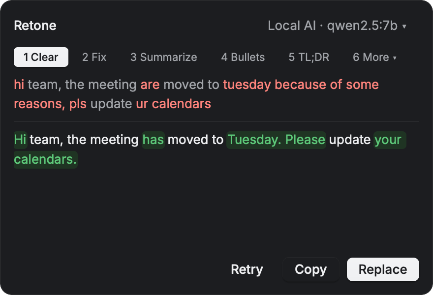
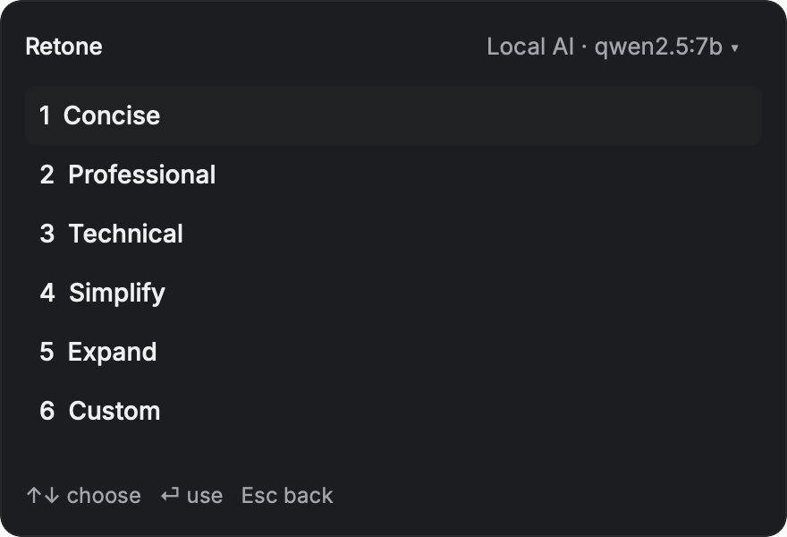
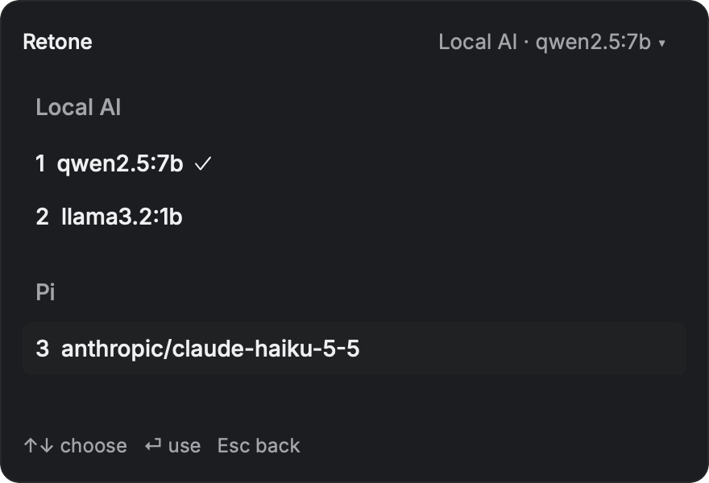
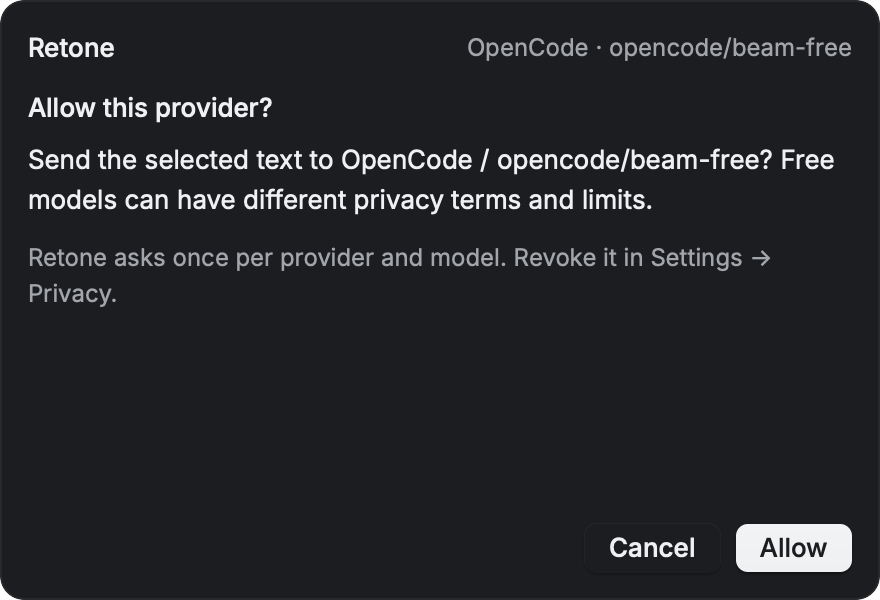

<p align="center">
  <picture>
    <source media="(prefers-color-scheme: dark)" srcset="assets/icon/logo-dark.svg">
    
  </picture>
</p>

<h1 align="center">Welcome to Retone 👋</h1>

<p align="center">
  <strong>Retone</strong> rewrites the text you select in any macOS app. Press your own hotkey, pick a style, and replace the text in place — with a local model or your own AI CLI.
</p>

<div align="center">

[](LICENSE) [](<>) [](<>) [](<>) [](https://github.com/anomalyco/rune) [](https://github.com/jellydn/retone/actions/workflows/ci.yml)

</div>

<div align="center">
  
</div>

> [!WARNING]
> **Beta.** Tested on macOS 26.6 and 27.2 on Apple Silicon, in TextEdit and Slack only. See [Known limits](#known-limits).

## Features

- ⌨️ **Your hotkey**, or the **right-click menu** (Fix Spelling and Grammar, Improve Writing, Summarize, Bullet Points, TL;DR)
- ✍️ **Styles**: Clear, Fix, Summarize, Bullets and TL;DR on number keys; press 6 for **More** (Concise, Professional, Technical, Simplify, Expand, your own)
- 👀 **Preview first**: the rewrite streams in with changes highlighted; Enter replaces, ⌘C copies, ⌘R retries, Esc cancels
- 🛡️ **Safe replace**: only when the same app, field and selection are still there; on failure nothing changes and your clipboard comes back
- 🏠 **Your model**: Ollama, LM Studio, llama.cpp or [Llama.app](https://llama.app) on this Mac (or your LAN/Tailscale after opt-in), or Pi, OpenCode, Claude Code and Codex; switch with ⌘P
- 🔒 **No history**: no text in logs or settings, consent per provider and model, 2,000-character limit

## Screenshots

<div align="center">
  
  
  <br/>
  
  
</div>

More on the [landing page](https://jellydn.github.io/retone/).

## Installation

Needs macOS 14 or later on Apple Silicon, and one AI provider.

```bash
brew tap jellydn/retone https://github.com/jellydn/retone
brew trust --cask jellydn/retone/retone   # Homebrew refuses casks from untrusted taps
brew install --cask retone
```

Run `brew update` first if `brew trust` is unknown. Or download the DMG or ZIP from [Releases](https://github.com/jellydn/retone/releases) (check it with `shasum -a 256 -c SHA256SUMS --ignore-missing`), or build it with `scripts/bundle.sh --release`.

> [!IMPORTANT]
> Retone is ad-hoc signed, so macOS can say that it "cannot be opened". Click **Open Anyway** in **System Settings → Privacy & Security**, or run `xattr -dr com.apple.quarantine /Applications/Retone.app`. See [TROUBLESHOOTING.md](TROUBLESHOOTING.md).

**Updates**: the beta does not update itself. Run `brew upgrade --cask retone`, or download the new DMG.

## Usage

1. Open **Settings → General** from the menu-bar item, record a hotkey, and grant **Accessibility** (without it, Retone uses the clipboard and never pastes).
2. Choose a provider in **Settings → Provider**.
3. Select text in any app and press your hotkey, or right-click it and choose a Retone item.
4. Pick a style with a number key, look at the preview, then press **Enter** to replace.

For Summarize and TL;DR, Enter copies and ⌘Enter replaces. The [guide](doc/guide.md) explains the right-click menu, Settings, providers, recommended local models and LAN/Tailscale servers.

## Known limits

- Not tested: apps other than TextEdit and Slack, macOS 14 and 15, Intel Macs, mixed-scaling displays and non-US keyboards.
- Grant Accessibility again after each update (ad hoc signing): remove Retone in **System Settings → Privacy & Security → Accessibility** and add it again.
- macOS does not let Retone hide its right-click items; Electron apps such as Slack and VS Code do not show them.
- Codex is not verified for no-history use, so Retone refuses it.

## 📝 Documentation

- [Guide](doc/guide.md) - Right-click menu, Settings, providers, local models and the no-history rules
- [TROUBLESHOOTING.md](TROUBLESHOOTING.md) - Gatekeeper, Accessibility and Homebrew issues
- [RELEASES.md](RELEASES.md) - Release process, signing and Sparkle setup
- [RELEASE_NOTES.md](RELEASE_NOTES.md) - Changes in each release
- [Architecture Decisions](doc/adr/) - ADRs for key technical decisions
- [Agent Guidelines](AGENTS.md) - Guidelines for contributors and coding agents

## 🤝 Contributing

Contributions are welcome! Run `cargo fmt --check`, `cargo clippy --all-targets` and `cargo test` before you open a PR, and read [AGENTS.md](AGENTS.md).

## 📜 License

This project is licensed under the MIT License - see the [LICENSE](LICENSE) file for details.

## Author

👤 **Dung Huynh**

- Website: [https://productsway.com](https://productsway.com)
- Twitter: [@jellydn](https://twitter.com/jellydn)
- GitHub: [@jellydn](https://github.com/jellydn)

## Show your support

Give a ⭐️ if this project helped you!

[](https://ko-fi.com/dunghd) [](https://paypal.me/dunghd) [](https://www.buymeacoffee.com/dunghd)
